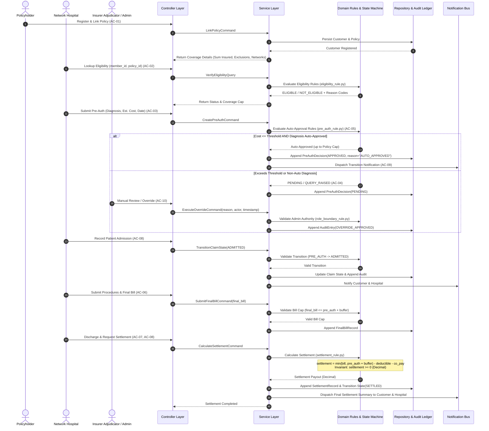
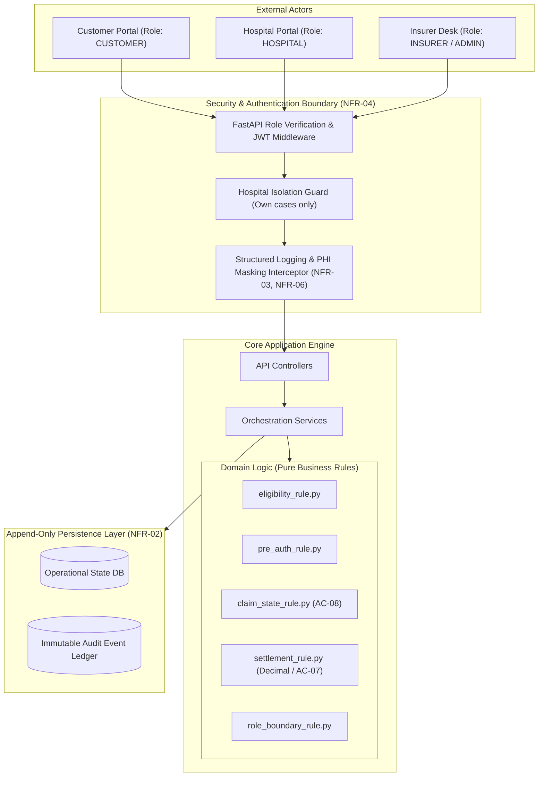

# Architecture Blueprint: MediCard Cashless Hospitalization & Settlement Platform
**Document ID**: ARCH-BC-017  
**Version**: 1.0.0  
**Target Domain**: Insurance — Health Cashless  

---

## 1. Architectural Principles & Layered Architecture

MediCard implements a clean, layered architecture designed to enforce domain isolation, strict dependency direction, testability, and non-negotiable compliance rules.

```
       +-------------------------------------------------------+
       |                   Presentation Layer                  |
       |     (Responsive Web SPA / Customer, Hospital, Insurer) |
       +-------------------------------------------------------+
                                  |
                                  v
       +-------------------------------------------------------+
       |                   Controller Layer                    |
       |  (FastAPI REST Endpoints, Role Auth Boundaries, DTOs) |
       +-------------------------------------------------------+
                                  |
                                  v
       +-------------------------------------------------------+
       |                    Service Layer                      |
       | (Orchestration, Transaction Control, Notification Bus)|
       +-------------------------------------------------------+
                                  |
                                  v
       +-------------------------------------------------------+
       |                     Domain Layer                      |
       | (Business Rules, Invariants, State Machine, Entities) |
       |     * ZERO DEPENDENCIES ON OUTER LAYERS OR DB *       |
       +-------------------------------------------------------+
                                  |
                                  v
       +-------------------------------------------------------+
       |                  Repository Layer                     |
       |   (SQLAlchemy ORM Data Access, Append-Only Ledger)    |
       +-------------------------------------------------------+
                                  |
                                  v
       +-------------------------------------------------------+
       |                    Database Layer                     |
       |          (SQLite Engine / In-Memory Test DB)          |
       +-------------------------------------------------------+
```

### Layer Responsibilities & Strict Dependency Rules

1. **Presentation Layer (`frontend/`)**:
   - Multi-party responsive user interface serving Customer, Hospital, Adjudicator, and Admin personas.
   - Communicates exclusively with the Controller layer via typed REST APIs.
2. **Controller Layer (`src/controllers/`)**:
   - HTTP request parsing, input validation using Pydantic schemas, and serialization.
   - Enforces **NFR-04** Authentication & Role Boundaries (`CUSTOMER`, `HOSPITAL`, `INSURER`, `ADMIN`).
   - Generates structured JSON request context (`request_id`, `correlation_id`) for **NFR-06**.
   - Dependent *only* on the Service layer.
3. **Service Layer (`src/services/`)**:
   - Orchestrates domain rule execution, coordinates repositories, and publishes stubbed notifications (**AC-09**).
   - Manages database transaction boundaries and audit event dispatch.
   - Dependent on the Domain and Repository interfaces.
4. **Domain Layer (`src/domain/`)**:
   - **The core source of truth for business logic**. Contains pure business rules, entities, and state machines.
   - **Strict Rule**: Domain rules MUST NOT import or depend directly on controllers, services, database drivers, or HTTP frameworks.
   - Enforces **NFR-01** fixed-point decimal arithmetic, settlement cap invariants, and `InvalidClaimStateException`.
5. **Repository Layer (`src/repositories/`)**:
   - Encapsulates database queries, persistence models, and table mappings via SQLAlchemy.
   - Enforces **NFR-02** and **NFR-05** append-only persistence semantics for decisions, bills, overrides, and settlements.
6. **Database Layer**:
   - Relational store (SQLite) with versioned, forward-only schemas.

---

## 2. End-to-End Eligibility-to-Settlement Sequence Diagram



---

## 3. Data Flow & Security Boundaries



---

## 4. Key Architectural Safeguards & NFR Mapping

| Requirement | Architectural Mechanism | Verification Test |
| :--- | :--- | :--- |
| **NFR-01 (Fixed-Point Arithmetic)** | All monetary fields (`estimated_cost`, `final_bill`, `pre_auth_amount`, `deductible`, `co_pay`, `settlement_amount`) are declared as `decimal.Decimal`. Prohibit `float` casting in domain calculations. | `tests/unit/test_ac07_settlement.py` and hook `settlement-cap-check` |
| **NFR-02 (Append-Only Ledger)** | Tables `pre_auth_decisions`, `claim_bills`, `claim_settlements`, and `audit_logs` have INSERT-only access with database-level immutability constraints. | `tests/architecture/test_append_only_rules.py` |
| **NFR-03 (PHI Redaction)** | Logging filter scrubs diagnostic terms, ICD codes, and clinical procedure text, substituting SHA-256 hashes or redacting to `[REDACTED_PHI]`. | `tests/architecture/test_phi_redaction.py` and hook `phi-redaction-check` |
| **NFR-04 (Role & Tenant Isolation)** | Hospital ID claims are compared against route parameters; hospitals cannot query cases belonging to other facilities. Admin routes require `INSURER` or `ADMIN` roles. | `tests/unit/test_role_boundary.py` |
| **NFR-06 (Structured JSON Logs)** | Application logger outputs single-line JSON with `request_id`, `correlation_id`, `case_id`, `actor`, and `event`. | `tests/unit/test_logging.py` |
| **NFR-07 (Health Endpoint SLA)** | `/health` returns `{"status": "healthy", "database": "connected"}` in < 100ms. | API integration test |
| **NFR-08 (Architecture Rules as Tests)** | Automated tests under `tests/architecture/` verify that controllers are not imported by domain modules, settlement formulas are not duplicated, and settled claims cannot be modified. | `tests/architecture/test_layer_dependencies.py` |
